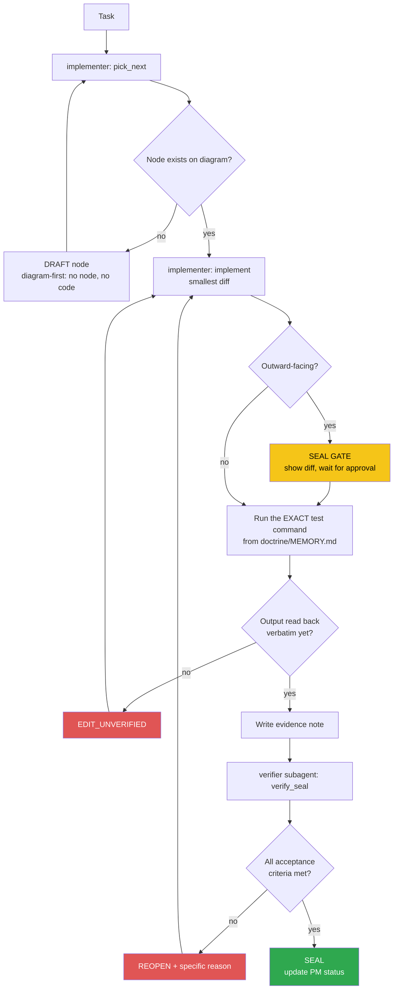

<!-- Diagram: dev-loop -->
<!-- Dev loop: plan - implement - verify - seal -->
DNA: 'smallest_diff / edit_x_read_back_proof_x_independent_verdict'
Auth: 65537 | Version: 1.0.0
Law: LAI-13 - monotonic ratchet (PENDING -> IN_PROGRESS -> SEALED, never demote)
States: PENDING, IN_PROGRESS, BLOCKED_<reason> (<-> IN_PROGRESS), SEALED (verifier only, final). REOPEN is a verdict (row stays IN_PROGRESS); DRAFT is creating a row (lands PENDING).

> Every repo code change enters here and exits as SEALED; a
> REOPEN verdict sends it back to implement, still IN_PROGRESS.

## PM status
> Older SEALED nodes (2026-08-22 through 2026-08-25; then a 2nd pass
> 2026-08-30 covering 7 more nodes dated 2026-08-29/2026-08-30; then a
> 3rd pass 2026-09-03 covering the 4 remaining full-content SEALED rows,
> dated 2026-08-30 through 2026-09-02) moved to
> `haven/diagrams/dev-loop-archive.md` to keep this file small — every
> worker session reads this file in full. Nothing deleted: the archive
> has each row's full original text verbatim. The compact rows below
> point to it; open the archive only when you need the full story
> behind an old node. `pick_next` only needs non-archived rows. Run
> `/hub-health` periodically — if this file flags >15KB again, repeat
> this archiving pass for nodes older than the current work session.
>
> Any regression must be a **new node** (LAI-13) — never edit an existing
> node's PM status directly to "undo" an existing SEAL.
>
> The table below is the LAST block of this file: a new row is appended
> at end-of-file (`AppendOnly`), a removed row is deleted with its line —
> no blank lines, no text after the table.

| Node | State | Notes |
|---|---|---|
| `fix-visit-real-client-ip` | SEALED | 2026-11-05 — archived, see `haven/diagrams/dev-loop-archive.md`. Evidence: `evidence/verifier/2026-11-05/fix-visit-real-client-ip-seal.md`. |
| `add-cv-file-name` | SEALED | 2026-11-05 — archived, see `haven/diagrams/dev-loop-archive.md`. Evidence: `evidence/verifier/2026-11-05/add-cv-file-name-seal-r2.md`. |
| `salary-desired-range` | SEALED | 2026-11-05 — archived, see `haven/diagrams/dev-loop-archive.md`. Evidence: `evidence/verifier/2026-11-05/salary-desired-range-seal.md`. |
| `add-project-type-experience-link` | SEALED | 2026-11-05 — archived, see `haven/diagrams/dev-loop-archive.md`. Evidence: `evidence/verifier/2026-11-05/add-project-type-experience-link-seal.md`. |
| `fix-project-link-optional` | SEALED | 2026-11-05 — archived, see `haven/diagrams/dev-loop-archive.md`. Evidence: `evidence/verifier/2026-11-05/fix-project-link-optional-seal.md`. |
| `fix-candidate-email-empty-query` | SEALED | 2026-11-07 — archived, see `haven/diagrams/dev-loop-archive.md`. Evidence: `evidence/verifier/2026-11-07/fix-candidate-email-empty-query-seal-r2.md`. |
| `fix-section-id-empty-query` | SEALED | 2026-11-07 — archived, see `haven/diagrams/dev-loop-archive.md`. Evidence: `evidence/verifier/2026-11-07/fix-section-id-empty-query-seal.md`. |
| `fix-candidate-password-leak` | PENDING | `src/candidate/candidate.service.ts` — `handlerGetInformationByEmail` has no `.select()` at all; `handlerGetInformationById` double-wraps `whitelistSelect([select])`, making the select a permanent no-op. Result: `GET /api/v1/candidate/:email` and `PUT/PATCH /candidate/update` return the raw bcrypt password hash in the response. |
| `fix-refresh-token-expiry-unused` | PENDING | `TOKEN_EXP_IN` (`.env`, already exported in config) is never used at any `jwtSign()` call site (`auth.service.ts`, `auth.controller.ts`, `api/v1/auth/services/login.ts`) — access and refresh tokens always share the same default 1h expiry, so the refresh token is pointless. |
| `reset-revokes-sessions` | SEALED | 2026-11-07 — archived, see `haven/diagrams/dev-loop-archive.md`. Evidence: `evidence/verifier/2026-11-07/reset-revokes-sessions-seal.md`. |
| `logout-revokes-refresh` | SEALED | 2026-11-07 — archived, see `haven/diagrams/dev-loop-archive.md`. Evidence: `evidence/verifier/2026-11-07/logout-revokes-refresh-seal.md`. |
| `atomic-token-consume` | SEALED | 2026-11-07 — archived, see `haven/diagrams/dev-loop-archive.md`. Evidence: `evidence/verifier/2026-11-07/atomic-token-consume-seal.md`. |
| `remove-get-login` | SEALED | 2026-11-07 — archived, see `haven/diagrams/dev-loop-archive.md`. Evidence: `evidence/verifier/2026-11-07/remove-get-login-seal.md`. |
| `restrict-query-token` | SEALED | 2026-11-07 — archived, see `haven/diagrams/dev-loop-archive.md`. Evidence: `evidence/verifier/2026-11-07/restrict-query-token-seal-r2.md`. |
| `fix-account-delete-cleanup` | SEALED | 2026-11-07 — archived, see `haven/diagrams/dev-loop-archive.md`. Evidence: `evidence/verifier/2026-11-07/fix-account-delete-cleanup-seal.md`. |
| `localize-education-school-major` | SEALED | 2026-11-02 — archived, see `haven/diagrams/dev-loop-archive.md`. Evidence: `evidence/verifier/2026-11-02/localize-education-school-major-seal.md`. |
| `add-familiar-skills` | SEALED | 2026-11-02 — archived, see `haven/diagrams/dev-loop-archive.md`. Evidence: `evidence/verifier/2026-11-02/add-familiar-skills-seal.md`. |

Any regression must be a **new node** (LAI-13) — never edit an existing
node's PM status directly to "undo" an existing SEAL.
| `fix-trim-strict-rejects-spaces` | SEALED | 2026-11-01 — archived, see `haven/diagrams/dev-loop-archive.md`. Evidence: `evidence/verifier/2026-11-01/fix-trim-strict-rejects-spaces-seal.md`. |
| `cast-legacy-localized-strings` | SEALED | 2026-11-05 — archived, see `haven/diagrams/dev-loop-archive.md`. Evidence: `evidence/verifier/2026-11-05/cast-legacy-localized-strings-seal-r2.md`. |
| `candidate-email-self-only` | SEALED | 2026-11-08 — archived, see `haven/diagrams/dev-loop-archive.md`. Evidence: `evidence/verifier/2026-11-08/candidate-email-self-only-seal-r2.md`. |
| `public-profile-field-whitelist` | SEALED | 2026-11-08 — archived, see `haven/diagrams/dev-loop-archive.md`. Evidence: `evidence/verifier/2026-11-08/public-profile-field-whitelist-seal.md` |
| `private-cv-storage` | SEALED | 2026-11-08 — archived, see `haven/diagrams/dev-loop-archive.md`. Evidence: `evidence/verifier/2026-11-08/private-cv-storage-seal-r2.md` |
