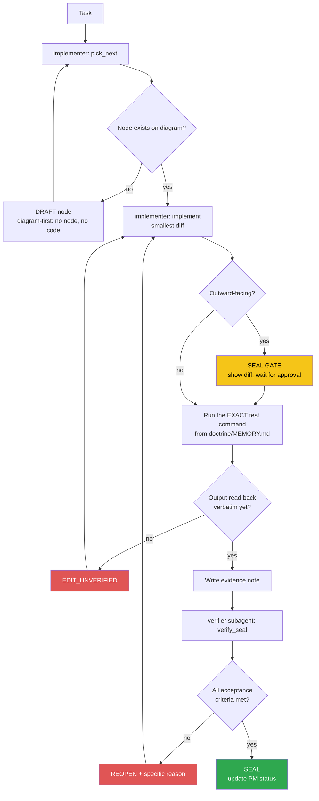

<!-- Diagram: dev-loop -->
<!-- Dev loop: plan - implement - verify - seal -->
DNA: 'smallest_diff / edit_x_read_back_proof_x_independent_verdict'
Auth: 65537 | Version: 1.0.0
Law: LAI-13 - monotonic ratchet (PENDING -> IN_PROGRESS -> SEALED, never demote)

> Every repo code change enters here and exits as SEALED or REOPENED — no
> other state exists in between.

## PM status
> Older SEALED nodes (2026-08-22 through 2026-08-25; then a 2nd pass
> 2026-08-30 covering 7 more nodes dated 2026-08-29/2026-08-30; then a
> 3rd pass 2026-09-03 covering the 4 remaining full-content SEALED rows,
> dated 2026-08-30 through 2026-09-02) moved to
> `haven/diagrams/dev-loop-archive.md` to keep this file small — every
> worker session reads this file in full. Nothing deleted: the archive
> has each row's full original text verbatim. The compact rows below
> point to it; open the archive only when you need the full story
> behind an old node. `pick_next` only needs non-archived rows. Run
> `/hub-tokens` periodically — if this file flags >15KB again, repeat
> this archiving pass for nodes older than the current work session.

| Node | State | Notes |
|---|---|---|
| `fix-candidate-password-leak` | PENDING | `src/candidate/candidate.service.ts` — `handlerGetInformationByEmail` has no `.select()` at all; `handlerGetInformationById` double-wraps `whitelistSelect([select])`, making the select a permanent no-op. Result: `GET /api/v1/candidate/:email` and `PUT/PATCH /candidate/update` return the raw bcrypt password hash in the response. |
| `fix-refresh-token-expiry-unused` | PENDING | `TOKEN_EXP_IN` (`.env`, already exported in config) is never used at any `jwtSign()` call site (`auth.service.ts`, `auth.controller.ts`, `api/v1/auth/services/login.ts`) — access and refresh tokens always share the same default 1h expiry, so the refresh token is pointless. |

| `add-public-ats-pdf-download` | SEALED | 2026-10-10 — archived, see `haven/diagrams/dev-loop-archive.md`. Evidence: `evidence/verifier/2026-10-16/add-public-ats-pdf-download-seal.md`. |

| `add-visit-profile-tracking` | SEALED | 2026-10-16 — archived, see `haven/diagrams/dev-loop-archive.md`. Evidence: `evidence/verifier/2026-10-16/add-visit-profile-tracking-seal.md`. |

| `add-refresh-token-reuse-detection` | SEALED | 2026-10-16 — archived, see `haven/diagrams/dev-loop-archive.md`. Evidence: `evidence/verifier/2026-10-16/add-refresh-token-reuse-detection-seal-r2.md`. |

| `add-application-profile-link` | SEALED | 2026-10-16 — archived, see `haven/diagrams/dev-loop-archive.md`. Evidence: `evidence/verifier/2026-10-16/add-application-profile-link-seal.md`. |
| `fix-refresh-rotation-race` | SEALED | 2026-10-18 — archived, see `haven/diagrams/dev-loop-archive.md`. Evidence: `evidence/verifier/2026-10-18/fix-refresh-rotation-race-seal.md`. |
| `fix-public-profile-deleted-entries` | SEALED | 2026-10-18 — archived, see `haven/diagrams/dev-loop-archive.md`. Evidence: see archived row. |
| `add-experience-career-break` | SEALED | 2026-10-19 — archived, see `haven/diagrams/dev-loop-archive.md`. Evidence: see archived row. |
| `docs-wiki-api-response-standard` | SEALED | 2026-10-24 — archived, see `haven/diagrams/dev-loop-archive.md`. Evidence: see archived row. |
| `fix-async-errors-and-404` | SEALED | 2026-10-21 — archived, see `haven/diagrams/dev-loop-archive.md`. Evidence: see archived row. |
| `fix-error-middleware-mapping` | SEALED | 2026-10-21 — archived, see `haven/diagrams/dev-loop-archive.md`. Evidence: `evidence/verifier/2026-10-21/fix-error-middleware-mapping-seal.md`. |
| `fix-status-codes` | SEALED | 2026-10-21 — archived, see `haven/diagrams/dev-loop-archive.md`. Evidence: `evidence/verifier/2026-10-21/fix-status-codes-seal.md`. |
| `services-throw-apperror` | SEALED | 2026-10-21 — archived, see `haven/diagrams/dev-loop-archive.md`. Evidence: `evidence/verifier/2026-10-21/services-throw-apperror-seal.md`. |
| `unified-error-envelope` | SEALED | 2026-10-21 — archived, see `haven/diagrams/dev-loop-archive.md`. Evidence: `evidence/verifier/2026-10-21/unified-error-envelope-seal.md`. |
| `audit-response-error-handling` | SEALED | 2026-10-24 — archived, see `haven/diagrams/dev-loop-archive.md`. Evidence: see archived row. |
| `remove-unused-files` | SEALED | 2026-10-24 — archived, see `haven/diagrams/dev-loop-archive.md`. Evidence: `evidence/verifier/2026-10-24/remove-unused-files-seal.md`. |

Any regression must be a **new node** (LAI-13) — never edit an existing
node's PM status directly to "undo" an existing SEAL.
| `fix-render-puppeteer-cache-dir` | SEALED | 2026-10-24 — archived, see `haven/diagrams/dev-loop-archive.md`. Evidence: `evidence/verifier/2026-10-24/render-puppeteer-cache-dir-seal.md`. |
| `add-security-headers` | SEALED | 2026-10-24 — archived, see `haven/diagrams/dev-loop-archive.md`. Evidence: `evidence/verifier/2026-10-24/add-security-headers-seal.md`. |
| `set-request-body-limit` | SEALED | 2026-10-24 — archived, see `haven/diagrams/dev-loop-archive.md`. Evidence: `evidence/verifier/2026-10-24/set-request-body-limit-seal.md`. |
| `claude-md-refactor` | SEALED | 2026-10-24 — archived, see `haven/diagrams/dev-loop-archive.md`. Evidence: `evidence/verifier/2026-10-24/claude-md-refactor-seal.md`. |
| `readme-vi-rewrite` | SEALED | 2026-10-24 — archived, see `haven/diagrams/dev-loop-archive.md`. Evidence: `evidence/verifier/2026-10-24/readme-vi-rewrite-seal.md`. |
